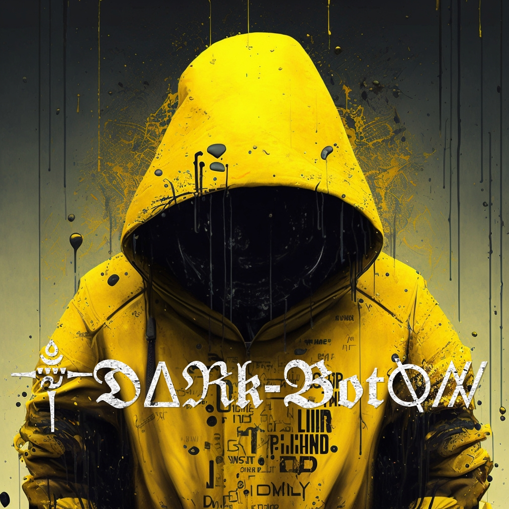

# DARK-BOTv2026

`BIENVENIDOS A DARK-BOTv2026 — AUTOMATIZACIÓN Y CONTROL EN WHATSAPP`
~~~bash
┍──━──━─────────┙◆┕───────━──━──┑

by 𝕯𐊅ℜ𝖐-𝕭𝖔𝖙⍉ꤲ

by 𝕮𝖆𝖗𝖑𝖔𝖘-𝖔𝖋𝖈

┕──━──━────────┑◆┍────────━──━──┙
~~~

❖

🛜`AQUI ENCONTRARAN LA APLICACIÓN DE 🟡TERMUX🟡`
~~~bash
▼▲▼▲▼▲▼▲▼▲▼▲▼▲▼▼▲▼▲▼▲▼▲▼▲▼▲▼▲▼

https://f-droid.org/packages/com.termux/

..todos los derechos reservados a termux❗

▼▲▼▲▼▲▼▲▼▲▼▲▼▲▼▼▲▼▲▼▲▼▲▼▲▼▲▼▲▼
~~~

❖

`⚠️NOTA⚠️`
~~~bash
DEBEN INSTALARLA Y DARLE EN PERMITIR EL USO DE ARCHIVO 📂 🗄️

CODIGOS PARA INSTALAR DEBEN DE SEGUIR LOS CODIGOS UNO POR UNO. NO TODOS A LA VEZ

𝙲𝙾𝙼𝙰𝙽𝙳𝙾𝚂 AH INTRODUCIR EN TERMUX
~~~

❖

■█■█■█■█■█■█■█■█■█■█■█■█■█■█■█■█■█■█■█■█■

`COMANDOS TERMUX🌐`
~~~bash

> cd

> termux-setup-storage

> apt update

> pkg upgrade

> pkg install git -y

> pkg install nodejs-lts -y

> pkg install ffmpeg -y

> pkg install imagemagick -y

> pkg install python -y

> pkg install make -y

> pkg install clang -y

> git clone https://github.com/DARK-BOT-OFC/DARK-BOTv2026.git

> cd DARK-BOTv2026

> npm install

> npm audit fix --force

> node index
~~~

■█■█■█■█■█■█■█■█■█■█■█■█■█■█■█■█■█■█■█■█■

❖

`⚠️NOTA DE RECORDATOR❗❗`
~~~bash
◥◢◣◤Cada vez que haya un error deben de dar tiempo

 para encontrarlo y una vez encontrado el error será

 solucionado se les quiere ◢◥◤◣
~~~

❖

~~~bash
*╭━━❍𝕯𐊅ℜ𝖐-𝕭𝖔𝖙⍉ꤲ❍━━╮

*┃ ┃ │❍  ACTUALIZACIÓN v2026 ❍*

*┃╭━━━━━━━━━━━━━━━━╾•*

*┃┃  ⋄ BASE Y CONEXIÓN:

*┃┃ ❍ Node.js + Baileys MD   ❍*

*┃┃ ❍ Emparejamiento rápido  ❍*

*┃┃  ⋄ ESTRUCTURA:

*┃┃ ❍ index.js / main.js / handler.js ❍*

*┃┃ ❍ Recursos en galería/  ❍*

*┃┣━━━━━━━━━━━━━━━━╾•*

*┃┃ ⋄ 𝕮𝖆𝖗𝖑𝖔𝖘-𝖔𝖋𝖈*

*┃┃ ⋄ 𝕯𐊅ℜ𝖐-𝕭𝖔𝖙⍉ꤲ 2026

*┃╰━━━━━━━━━━━━━━━━╾•*

*╰━━━╼𝕯𐊅ℜ𝖐-𝕭𝖔𝖙⍉ꤲ╾━━━╯*
~~~

❖

◆◇◆◇◆◇◆◇◆◇◆◇◆◇◆◇◆◇◆◇◆◇◆◇◆◇◆◇◆◇◆◇◆◇◆◇◆◇◆◇

`FUNCIONES🦾`
~~~bash
- Moderación de grupos (antilink, bienvenidas y control)
- Stickers (s, autosticker y sa)
- Descargas multimedia (play)
- Chatbot y comandos modulares en plugins/
- Gestión con database.js y apis.js
❗❗
~~~
